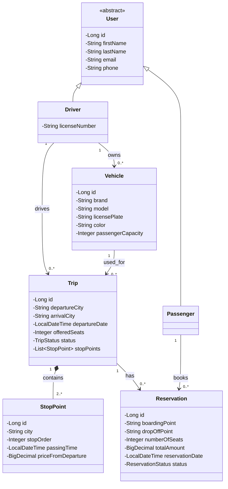

# Plateforme de Covoiturage

Une application backend robuste développée avec **Spring Boot 4 / Java 21** pour la gestion de covoiturage (trajets, conducteurs, passagers, réservations et véhicules).

---

## Sommaire

- [Fonctionnalités & Domaine](#fonctionnalités--domaine)
- [Technologies Utilisées](#technologies-utilisées)
- [Prérequis](#prérequis)
- [Configuration de l'Environnement](#configuration-de-lenvironnement)
- [Démarrage Rapide](#démarrage-rapide)
  - [Avec Docker & Docker Compose (Recommandé)](#avec-docker--docker-compose-recommandé)
  - [En Local (Maven)](#en-local-maven)
- [Modèle de Données](#modèle-de-données)
- [Structure du Projet](#structure-du-projet)

---

## Fonctionnalités & Domaine

L'application permet la gestion complète d'une plateforme de covoiturage :

- **Utilisateurs & Rôles** :
  - **Conducteurs (`Driver`)** : Informations personnelles et permis de conduire.
  - **Passagers (`Passenger`)** : Réservation et participation aux trajets.
- **Véhicules (`Vehicle`)** : Association avec un conducteur, gestion de la marque, modèle, plaque d'immatriculation et capacité de passagers.
- **Trajets (`Trip`)** :
  - Définition des villes de départ et d'arrivée, date et heure de départ, places disponibles.
  - Gestion des statuts : `PUBLISHED`, `FULL`, `COMPLETED`, `CANCELLED`.
  - Points d'arrêt intermédiaires (`StopPoint`) avec ordre de passage, horaire et tarification.
- **Réservations (`Reservation`)** :
  - Réservation par un passager pour un trajet spécifique.
  - Définition du point de montée et de dépose, nombre de places réservées et montant total.
  - Statuts : `CONFIRMED`, `CANCELLED`.

---

## Technologies Utilisées

- **Langage** : Java 21
- **Framework** : Spring Boot 4.1.2 (Spring Data JPA, Spring Web MVC, Bean Validation)
- **Base de données** : PostgreSQL 18 (production / docker), H2 Database (tests / local dev)
- **Mapping & Utilitaires** : MapStruct 1.5.5, Lombok
- **Conteneurisation** : Docker, Docker Compose

---

## Prérequis

- [Java 21 JDK](https://adoptium.net/) (si exécution locale)
- [Docker](https://docs.docker.com/get-docker/) & [Docker Compose](https://docs.docker.com/compose/)

---

## Configuration de l'Environnement

Un fichier exemple [.env.example](.env.example) est fourni à la racine. Créez un fichier `.env` si ce n'est pas déjà fait :

```bash
cp .env.example .env
```

Variables d'environnement disponibles :

| Variable | Description | Valeur par défaut |
|---|---|---|
| `POSTGRES_DB` | Nom de la base PostgreSQL | `covoiturage` |
| `POSTGRES_USER` | Utilisateur de la base de données | `covoiturage` |
| `POSTGRES_PASSWORD` | Mot de passe de la base | `covoiturage` |
| `POSTGRES_PORT` | Port PostgreSQL (hôte) | `5432` (exposé en `5433` via docker-compose) |
| `DB_HOST` | Hôte de la base de données | `covoiturage-db` (docker) ou `localhost` |
| `DB_PORT` | Port de connexion à la base | `5432` |
| `DB_NAME` | Nom de la base de données | `covoiturage` |
| `DB_USER` | Utilisateur de connexion Spring | `covoiturage` |
| `DB_PASSWORD` | Mot de passe de connexion Spring | `covoiturage` |
| `APP_PORT` | Port interne Spring Boot | `8080` (exposé sur `8081` sur l'hôte) |
| `SPRING_PROFILES_ACTIVE` | Profil Spring actif | `dev` |
| `TZ` | Fuseau horaire de l'application | `Africa/Casablanca` |

---

## Démarrage Rapide

### Avec Docker & Docker Compose (Recommandé)

1. **Construire et lancer les conteneurs (Base de données + Application)** :
   ```bash
   docker compose up -d --build
   ```
   Le `Dockerfile` est multi-étapes : l'étape Maven exécute
   `mvn clean package -DskipTests` dans le conteneur, il n'est donc pas
   nécessaire de lancer `./mvnw package` sur la machine hôte.

2. **Vérifier l'état des conteneurs** :
   ```bash
   docker compose ps
   ```

3. **Accéder aux services** :
   - **API Backend** : [http://localhost:8081](http://localhost:8081)
   - **PostgreSQL** : `localhost:5433` (identifiants définis dans `.env`)

4. **Consulter les logs** :
   ```bash
   docker compose logs -f app
   ```

5. **Arrêter les conteneurs** :
   ```bash
   docker compose down
   ```

6. **Repartir d'une base vierge** (supprime aussi le volume PostgreSQL) :
   ```bash
   docker compose down -v
   ```

---

### En Local (Maven)

1. **Démarrer uniquement la base de données PostgreSQL** :
   ```bash
   docker compose up -d db
   ```

2. **Lancer l'application Spring Boot** :
   ```bash
   ./mvnw spring-boot:run
   ```

---

## Modèle de Données



> **`User` est une classe `@MappedSuperclass`** : elle ne crée pas de table.
> Ses attributs sont hérités par `Driver` et `Passenger` (ils ne sont donc pas
> répétés ici), et physiquement dupliqués dans les colonnes de `drivers` et
> `passengers`. Seul `Driver` ajoute `licenseNumber`.

---

## Structure du Projet

```text
covoiturage/
├── compose.yml              # Configuration Docker Compose (App + PostgreSQL)
├── Dockerfile               # Image Docker pour le déploiement du conteneur Spring Boot
├── .env.example             # Modèle des variables d'environnement
├── pom.xml                  # Dépendances Maven et configuration du build
├── documents/               # Documentation et brief fonctionnel
│   ├── brief-*.pdf
│   └── shema.txt
└── src/
    ├── main/
    │   ├── java/com/youcode/covoiturage/
    │   │   ├── CovoiturageApplication.java
    │   │   ├── entity/      # Entités JPA (User, Driver, Passenger, Vehicle, Trip, etc.)
    │   │   └── enums/       # Énumérations métier (TripStatus, ReservationStatus)
    │   └── resources/
    │       ├── application.properties
    │       └── application-dev.properties
    └── test/                # Tests unitaires et d'intégration
```
